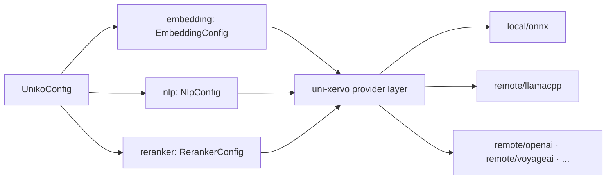

# Configuration

Configuration is a Rust value, not a config server. Because uniko runs
entirely in-process, every model, threshold, and pipeline cadence is a field
on one struct — `UnikoConfig`, in `uniko-store` — that you set before the
[`KnowledgeBase`](../concepts/architecture.md) opens. Start from
`UnikoConfig::default()`, override what you care about, and call `validate()`
to catch constraint violations before they reach the database.

```rust
use uniko_store::config::{UnikoConfig, EmbeddingConfig};

let mut config = UnikoConfig::default();
config.embedding = EmbeddingConfig::nomic_v15(); // swap the embedder
config.recall_limit = 20;                        // widen the recall bundle
config.validate()?;                              // fail fast on bad combos
```

!!! note
    `UnikoConfig` derives `Serialize` / `Deserialize`, and the struct
    carries `#[serde(default)]`. An empty JSON object (`{}`) deserialises
    to exactly `UnikoConfig::default()`, and any field you omit falls
    back to its spec default. This is what lets the benchmark harness
    layer a JSON profile on top of the defaults without re-stating every
    knob.

From Python, pass the same fields as a dict to `UnikoBuilder.config()`. Nested
sections such as `embedding` and `reranker` can be partial too, and an unknown
key raises `ConfigError` rather than being ignored:

```python
import uniko

memory = (uniko.Uniko.builder()
    .config({"recall_limit": 20, "reranker": {"top_n": 60}})
    .embedding("nomic")
    .build_sync())
print(memory.config()["recall_limit"])  # 20
```

See the [Python API reference](../python/api.md#configuration) for the
precedence rules.

---

## Swappable models

uniko's NLP, embedding, and reranking models all resolve through the
**uni-xervo** provider layer. A model is named by a provider id (e.g.
`local/onnx`, `remote/llamacpp`, `remote/openai`) plus a model id; xervo
loads and warms it. Because the model selection is data, not code, you
swap a model by editing config fields — no recompile of the pipeline.



### The embedder

The embedder controls auto-embedding (Message, Chunk, Observation,
Summary) and the computed embeddings on Entity, Fact, Topic, Session,
and the rest of the graph. The default is **BGE-small-en-v1.5** at 384
dimensions, served by the bundled `local/onnx` provider.

`EmbeddingConfig` ships several presets as constructor functions, plus a
`preset(name)` lookup for string-keyed selection:

=== "Default (BGE-small)"

    ```rust
    use uniko_store::config::EmbeddingConfig;

    // 384d, BERT-based, query-side prefix only — the default.
    let embed = EmbeddingConfig::bge_small_en_v15();
    ```

=== "Nomic v1.5 (768d)"

    ```rust
    // 768d, 8192 context. Adds search_document:/search_query: prefixes.
    let embed = EmbeddingConfig::nomic_v15();
    ```

=== "By name"

    ```rust
    // Returns None for an unknown name — callers print the canonical list.
    let embed = EmbeddingConfig::preset("bge-large")
        .expect("known preset");
    ```

The presets and their key properties, all defined in
`uniko-store::config`:

| Preset name        | Constructor                       | `model_id`                              | Dims | Notes |
|--------------------|-----------------------------------|-----------------------------------------|------|-------|
| `bge-small`        | `bge_small_en_v15()`              | `BGESmallENV15`                         | 384  | Default. Query-side prefix only. |
| `bge-large`        | `bge_large_en_v15()`              | `BGELargeENV15`                         | 1024 | Top-tier MTEB quality; ~10× the params of BGE-small, expect 2–3× slower per-query embedding. |
| `nomic`            | `nomic_v15()`                     | `NomicEmbedTextV15`                     | 768  | 8192 context; needs `search_document:`/`search_query:` prefixes. |
| `nomic-q` / `nomic-quantized` | `nomic_v15_quantized()` | `NomicEmbedTextV15Q`                    | 768  | Quantized — faster, lower memory. |
| `minilm`           | `minilm_l6_v2()`                  | `AllMiniLML6V2`                         | 384  | Legacy default for existing databases; no task prefixes. |
| `embeddinggemma` / `gemma` | `embedding_gemma_300m()`  | `onnx-community/embeddinggemma-300m-ONNX` | 768  | 300M-param Gemma-3 retrieval embedder via the `local/onnx` HF-Hub fallback. |
| `bge-m3`           | `bge_m3()`                        | `aapot/bge-m3-onnx`                     | 1024 | **Hybrid**: also emits a 250,002-dim learned-sparse vector and a 1024-dim ColBERT multi-vector. See [Sparse + ColBERT hybrid retrieval](#sparse-colbert-hybrid-retrieval). |

!!! warning
    The embedding dimension is part of the on-disk vector index. The
    `dimensions` field must match the model's true output, and you
    cannot change the embedder under an existing database without
    re-indexing — the index was built at the original dimension. Pick
    the embedder up front. `validate()` rejects a zero `dimensions` or
    `batch_size`, but it cannot detect a model/dimension mismatch.

Each preset also sets the right task prefixes. Nomic uses
`document_prefix = "search_document: "` and
`query_prefix = "search_query: "`; BGE uses a query-only prefix
(`"Represent this sentence for searching relevant passages: "`); MiniLM
uses none. These are baked into the preset because the retriever was
trained on those literal strings.

By default the embedder resolves through `local/onnx`. To route
embeddings to an OpenAI-compatible endpoint instead, set the `provider`
to `"remote/openai"` and pass `provider_options` (this is where a
`base_url` lands):

```rust
let mut embed = EmbeddingConfig::bge_small_en_v15();
embed.provider = "remote/openai".into();
embed.provider_options = Some(serde_json::json!({
    "base_url": "http://litellm-cloud:4000/v1"
}));
```

A llama.cpp `llama-server` has its own constructor, because two of its
options have no defensible default — both describe how you launched the
server rather than which model it holds:

```rust
// model id, base_url (including /v1), dimensions, max_input_tokens
let embed = EmbeddingConfig::llamacpp("bge-small", "http://127.0.0.1:8080/v1", 384, 512);
```

`llama-server` never silently truncates embedding input: encoder models
are non-causal, so an over-long prompt is **rejected** rather than cut
down. uni-xervo pre-trims against `max_input_tokens` using the server's
own `/tokenize` endpoint, so keep that budget at or below the server's
`--ubatch-size` and `--ctx-size`. It counts the `[CLS]`/`[SEP]` specials
(512 for BGE). Task prefixes are left unset — set `document_prefix` /
`query_prefix` yourself to match whichever model the server holds.

### The NLP model

NER and observation extraction run through a kniv NLP model. The default
is the v1 cascade, **kniv-deberta** (one ONNX graph over at most 128
subwords). Every size of **kniv v7** is available as an alternative: v7
reads whole windows of up to 1,024 subwords, so each sentence is analysed
with its neighbours in view.

Pick one by preset with `NlpConfig::preset` (or `UnikoBuilder::nlp`):

| Preset        | Model                                   | Encoder |
|---------------|-----------------------------------------|---------|
| `v1`          | `dragonscale-ai/kniv-deberta-nlp-base-en-xsmall` | DeBERTa, 128 subwords (default) |
| `v7-tiny`     | `dragonscale-ai/kniv-v7-tiny-en`        | Ettin 17M |
| `v7-small`    | `dragonscale-ai/kniv-v7-small-en`       | Ettin 32M |
| `v7-medium`   | `dragonscale-ai/kniv-v7-medium-en`      | Ettin 68M |
| `v7-large`    | `dragonscale-ai/kniv-v7-large-en`       | ModernBERT-base |
| `v7-xlarge`   | `dragonscale-ai/kniv-v7-xlarge-u-en`    | UltraBERT 380M |
| `v7-xlarge-d` | `dragonscale-ai/kniv-v7-xlarge-d-en`    | DeBERTa-v3-large, 512 subwords |

```rust
use uniko_api::tools::NlpConfig;

let memory = Uniko::builder()
    .nlp(NlpConfig::preset("v7-small").expect("known preset"))
    .build()
    .await?;
```

```python
memory = uniko.Uniko.builder().nlp("v7-small").build_sync()
```

The presets fill in these fields; set them directly for a model of your own:

| Field                | Default | Meaning |
|----------------------|---------|---------|
| `model_id`           | `dragonscale-ai/kniv-deberta-nlp-base-en-xsmall` | HuggingFace id of the model. |
| `generation`         | `v1`    | Which kniv generation `model_id` is: `v1` or `v7`. Must match the model; the two take different loader options. |
| `artifact`           | `onnx/cascade-int8.onnx` | v1 only: which ONNX export under `model_id/` to load (e.g. INT8 vs FP32). |
| `variant`            | `int8`  | v7 only: the precision to load, as a fallback chain such as `int8,fp16`. Each graph falls back to fp32, which every release ships. |
| `max_batch_size`     | `16`    | Maximum batch size for the ONNX session. |
| `execution_providers`| `None`  | EP override; `None` picks a feature-aware default (CUDA+CPU on `gpu-cuda`, CoreML+CPU on `gpu-metal`, CPU otherwise). |

Both generations feed the same extraction: they share the entity (OntoNotes),
part-of-speech, dependency and semantic-role labels. v7's six dialogue acts
are mapped onto the v1 sentence classes that decide which sentences yield
observations (`Directive` counts as a request and `Commissive` as an offer,
so both stay informative). The model is not recorded in the store, so a
store can be reopened with another one. A `catalog_path` replaces the
built-in catalog, `nlp` section included.

The SRL (semantic-role-labelling) head is gated separately on the main
config:

```rust
config.nlp_srl_enabled = true; // default: true
```

When `true`, the pipeline computes SRL frames (one extra ONNX forward
per VERB per sentence) and downstream extraction uses them. Set it to
`false` if profiling shows the per-verb re-forward cost is unacceptable
for a workload; `NlpResult.srl_frames` then stays empty and extraction
behaves as before.

### The reranker

After hybrid recall fuses candidates with reciprocal rank fusion, an
optional cross-encoder re-scores the top `top_n` items. The reranker is
**enabled by default** with `cross-encoder/ms-marco-MiniLM-L-6-v2`:

```rust
use uniko_store::config::RerankerConfig;

let rr = RerankerConfig::default();
// enabled:       true
// model_id:      "cross-encoder/ms-marco-MiniLM-L-6-v2"
// top_n:         50
// apply_sigmoid: true
// style:         "cross-encoder"
```

| Field                | Default | Meaning |
|----------------------|---------|---------|
| `enabled`            | `true`  | Register and invoke the reranker. |
| `model_id`           | `cross-encoder/ms-marco-MiniLM-L-6-v2` | Cross-encoder ONNX export. |
| `top_n`              | `50`    | Number of top RRF candidates re-scored. Must be `>= recall_limit` when enabled. |
| `apply_sigmoid`      | `true`  | Map raw logits to `[0, 1]` via sigmoid. |
| `style`              | `cross-encoder` | `"cross-encoder"` for BERT-family encoders; `"generative"` for decoder-LM rerankers (e.g. Qwen3-Reranker); `"colbert"` for in-process ColBERT MaxSim (no reranker model — requires `multivector_dimensions`). |
| `execution_providers`| `None`  | EP override, same semantics as the embedder. |

`RerankerConfig` ships two presets:
`RerankerConfig::minilm_l6()` (22M params, the default model) and
`RerankerConfig::bge_base()` (`BAAI/bge-reranker-base`, 278M params,
more accurate, CPU-feasible). Both construct with `enabled: false`; the
`Default` impl flips MiniLM on.

!!! tip
    MiniLM is 12× faster than BGE-reranker-base, so default-on rerank is
    cheap relative to the rest of recall. To turn it off entirely:

    ```rust
    config.reranker = RerankerConfig { enabled: false, ..Default::default() };
    ```

!!! warning
    When the reranker is enabled, `validate()` requires
    `reranker.top_n >= recall_limit`. If you raise `recall_limit` above
    `top_n` (default 50), bump `top_n` to match or validation fails —
    otherwise truncation would discard items the reranker never saw.

---

## Tunable thresholds

`UnikoConfig` exposes the numeric knobs that govern the recall cascade,
hybrid fusion, consolidation, and memory decay. All defaults below are
from `UnikoConfig::default()`.

### Recall and fusion

| Field                       | Default | Meaning |
|-----------------------------|---------|---------|
| `recall_limit`              | `15`    | Maximum items returned from recall. |
| `recall_token_budget`       | `8192`  | Maximum total tokens in the context bundle. |
| `recall_min_score`          | `0.001` | Minimum fused score for inclusion. |
| `recall_vector_weight`      | `0.5`   | Vector-similarity weight in hybrid fusion `[0.0–1.0]`. |
| `recall_bm25_weight`        | `0.5`   | BM25 fulltext weight in hybrid fusion `[0.0–1.0]`. |
| `recall_lexical_enabled`    | `true`  | Phase 3 lexical channel over `Chunk.search_text`, matching identifiers and figures whole; see [Tool Output](tool-output.md). |
| `recall_fact_hybrid`        | `true`  | Fuse BM25 over `Fact.object` into Phase 1's Fact search. |
| `rrf_k`                     | `60.0`  | `k` constant for reciprocal rank fusion across query variants; higher flattens top-rank weighting. |
| `recall_per_variant_limit`  | `None`  | LIMIT applied to each per-variant Cypher query; `None` falls back to `recall_limit`. |
| `query_variants`            | `[]`    | Multi-query reformulation labels. Empty (the default) selects the **single** `keywords` variant. Pass all four — `keywords`, `original`, `declarative`, `type_anchored` — to opt into multi-query. |

### Cascade phase gates

The recall cascade runs in phases and exits early once a phase covers
the query. Coverage gates and the Phase 1 strategy live here:

| Field                          | Default   | Meaning |
|--------------------------------|-----------|---------|
| `phase2_coverage_threshold`    | `0.65`    | Coverage threshold for Phase 2 (Expand) early exit. |
| `phase1_strategy`              | `"boost"` | Phase 1 contribution strategy: `merge`, `boost`, or `off`. |
| `phase1_boost_alpha`           | `0.6`     | Multiplicative weight for Fact scores in the session-chunk boost under `phase1_strategy = "boost"`. |
| `phase2_mmr_lambda`            | `0.7`     | MMR relevance-vs-diversity for Phase 2 dedup (`1.0` = pure relevance, `0.0` = pure diversity). |
| `phase2_mmr_duplicate_threshold` | `0.85`  | Token-overlap threshold above which a Phase 2 candidate is dropped as a hard duplicate. |
| `phase2_temporal_enabled`      | `true`    | Temporal-interval channel; fires only when the query has a parsed temporal phrase. |
| `phase2_graph_enabled`         | `true`    | Graph spreading-activation channel; fires only when the query has a resolvable entity seed. |
| `phase2_graph_damping`         | `0.85`    | PPR damping factor for the graph channel. |
| `phase2_graph_max_iter`        | `30`      | PPR power-iteration cap for the graph channel. |
| `phase2_graph_edge_weights`    | `{}`      | Per-edge-type weight multipliers for graph propagation; empty map uses the built-in `default_phase2_graph_edge_weights`. |

!!! important "`boost` needs finalized sessions"
    The `boost` strategy scores **session-level chunks**, which are built by
    `Session::finalize()` (and, best-effort, by `Session::summarize()`). A
    session that is never finalized has no such chunks, so Phase 1 contributes
    nothing under the default strategy. Call `finalize()` at the end of a
    conversation, or use `Agent::finalize_session` / `unfinalized_session_ids`
    to backfill an existing knowledge base.

!!! note
    `phase2_coverage_threshold` must be
    in `(0.0, 1.0]`; `validate()` rejects values outside that range. The
    `phase1_strategy` is stored as a string (not an enum) so configs
    deserialised across feature flags stay compatible.

### Entity admission

Strict admission keeps NER noise out of the `:Entity` graph at ingest time —
temporal, measurement, and quoted-string spans (already captured as
observations) and greeting/discourse fragments mis-tagged as people are
dropped, and the low-confidence catch-all is gated:

| Field                          | Default | Meaning |
|--------------------------------|---------|---------|
| `entity_strict_admission`      | `true`  | Drop NER noise and greeting fragments. Set `false` to restore legacy admit-everything behavior (for A/B comparison). |
| `entity_other_min_confidence`  | `0.9`   | Minimum confidence for an `Other` catch-all span (Event/Product/WorkOfArt/Group/Misc) to be admitted when strict admission is on. |

### Consolidation

Consolidation (P4) collapses near-duplicate Facts and refreshes their
embeddings:

| Field                                   | Default | Meaning |
|-----------------------------------------|---------|---------|
| `consolidation_threshold`               | `20`    | Number of observations that trigger consolidation. |
| `consolidation_interval_secs`           | `900`   | Seconds between periodic consolidation runs. |
| `consolidation_cluster_objects`         | `true`  | Cosine-cluster object surface forms before mode-voting picks the canonical (vs legacy exact-string buckets). |
| `consolidation_date_augment_embedding`  | `true`  | Prepend a month-year prefix (from the Fact's `first_observed`) to the embedded Fact text so temporally-near Facts co-locate. |

### Memory decay

Episode importance decays exponentially, and Episodes whose decayed
importance falls to the threshold are pruned (the `relevance_decay` sweep,
run on the cortex cadence):

```rust
config.half_life_days = 30.0; // importance * exp(-ln(2)/half_life * age_days)
config.prune_below   = 0.05;  // prune Episodes at or below this importance
```

| Field            | Default | Meaning |
|------------------|---------|---------|
| `half_life_days` | `30.0`  | Half-life (days) for importance decay. Must be positive. |
| `prune_below`    | `0.05`  | Decayed-importance threshold at or below which Episodes are pruned. Must be in `[0.0, 1.0)`. |

### Chunking and sessions

The chunking thresholds match the ingest pipeline's content router:

| Field                              | Default | Meaning |
|------------------------------------|---------|---------|
| `message_chunk_threshold`          | `1024`  | Token count above which a Message is chunked (below this it embeds directly). |
| `action_output_artifact_threshold` | `256`   | Token count above which an Action output overflows to an Artifact. |
| `max_chunk_tokens`                 | `256`   | Maximum tokens per chunk. |
| `min_chunk_tokens`                 | `32`    | Minimum tokens per chunk (fragments below this merge). |
| `chunk_overlap_tokens`             | `0`     | Overlap tokens between adjacent chunks; `0` = auto (10% of max, capped at 50). |
| `chunk_context_max_tokens`         | `64`    | Token budget for a tool-output chunk's context header (tool, address, inherited values). |
| `session_inactivity_secs`          | `3600`  | Inactivity window after which an open Session auto-closes and is summarised; `0` disables. |

!!! note
    `validate()` requires `min_chunk_tokens < max_chunk_tokens`. The
    design rationale and per-content-type chunking strategies (recursive
    splitting, tree-sitter AST, DOM sections, etc.) are described in the
    ingest pipeline; these fields are the runtime levers over that
    machinery.

### Vector index

The index algorithm and distance metric are set once at database
creation:

```rust
use uniko_store::config::{VectorAlgorithm, VectorMetricChoice};

config.vector_algorithm = VectorAlgorithm::HnswSq { m: 16, ef_construction: 100 };
config.vector_metric    = VectorMetricChoice::Cosine;
```

The default is `HnswSq { m: 16, ef_construction: 100 }` with `Cosine`
distance. Other variants cover `HnswFlat`, `HnswPq`, `IvfSq`, `IvfPq`,
and `IvfRq` for different scale / recall / memory trade-offs.

Reopening a store with a different algorithm or metric, `embedding.query_prefix` or
`embedding.batch_size` is refused with `UnikoError::IncompatibleStore` until you run the
`rebuild_vector_indexes` migration. A PQ variant with `sub_vectors: 0` (automatic) is compared
with the count uni-db resolved and stored, so it reopens unchanged. Changing the embedding model,
its dimensions or `embedding.document_prefix` needs a fresh store, since the stored vectors were
made with the old ones. See [Changing the Embedding Model](model-migration.md).

### Pipelines and circuit breaker

| Field                         | Default  | Meaning |
|-------------------------------|----------|---------|
| `ingest_queue_capacity`       | `200`    | Bounded channel capacity for the ingest worker. |
| `consolidation_queue_capacity`| `32`     | Bounded channel capacity for the consolidation worker. |
| `circuit_failure_threshold`   | `5`      | Consecutive failures before the circuit breaker opens. |
| `circuit_recovery_ms`         | `60000`  | Milliseconds the breaker stays open before probing. |
| `dead_letter_max_retries`     | `3`      | Retries a dead-lettered streaming item gets before it is `exhausted`; fixed on each letter when stored. `0` stores every failure `exhausted`. |
| `dead_letter_auto_retry`      | `false`  | Retry dead letters in the background once their backoff elapses (checked every backoff interval, between 1 s and 60 s). |
| `dead_letter_retry_backoff_ms`| `30000`  | Wait before a dead letter's first retry; doubles on each later one. |
| `dead_letter_retry_max_backoff_ms` | `3600000` | Longest wait between retries of one dead letter. |

These configure the streaming pipeline (`streaming(true)` on the builder).
`validate()` rejects a queue capacity of `0`, and a retry backoff of `0` or one longer than the
maximum backoff.

### Blob storage and external files

| Field                     | Default        | Meaning |
|---------------------------|----------------|---------|
| `blob_storage`            | `BlobStorage::Lance` | Backend for `:ArtifactContent` bytes; persisted on first open. Reopening with a different variant is a hard error (no implicit migration). |
| `catalog_path`            | `None`         | Override the built-in xervo model catalog with a JSON file. |
| `schema_path`             | `None`         | Load the schema from a JSON file instead of registering it programmatically. Skips the open-time store compatibility check (a changed model or dimensions is still refused, with `Config`), and `migrate_store` refuses a config that sets it. |
| `observation_rules_path`  | `None`         | Load observation-extraction patterns from a YAML file instead of the bundled `english.yml`. |

### Remote storage

`remote_storage` keeps a store's data in an object store: its graph tables, indexes and schema.
It is `None` by default, which keeps everything under the path. The path given to `open` picks
how the store is split:

- **Hybrid**: the path is a local directory. It holds the store's write-ahead log and id
  allocator, and commits reach the bucket at each flush. Writes are as fast as a local store's.
- **Remote-only**: the path is the store's own URL, the same as `remote_storage.url`. Everything,
  the write-ahead log included, is in the bucket, so any host can open the store with nothing
  local. Each commit waits on the bucket.

```rust
let config = UnikoConfig {
    remote_storage: Some(
        RemoteStorage::s3("s3://my-bucket/kb")
            .with_endpoint("http://localhost:4566") // an S3-compatible service; omit for AWS
            .with_region("us-east-1"),
    ),
    ..UnikoConfig::default()
};
// Hybrid:
let memory = Uniko::builder().path("./kb-local").raw_config(config.clone()).build().await?;
// Or remote-only:
let memory = Uniko::builder().path("s3://my-bucket/kb").raw_config(config).build().await?;
```

For Azure Blob Storage, name the container in an `az://` URL and the storage account it is in:

```rust
let remote = RemoteStorage::azure("az://my-container/kb", "mystorageaccount")
    .with_access_key(std::env::var("MY_ACCOUNT_KEY")?); // or .with_sas_token(...)
```

In Python, pass it as a mapping: `.config({"remote_storage": {"url": "s3://my-bucket/kb", ...}})`,
or `{"url": "az://my-container/kb", "account": "mystorageaccount", "access_key": ...}`.

A remote-only store can also be opened by its URL with no `remote_storage` at all, taking every
setting from the environment variables below.

| Field                  | Meaning |
|------------------------|---------|
| `url`                  | `s3://bucket[/prefix]` (S3 and S3-compatible services: MinIO, LocalStack, R2), `gs://bucket[/prefix]` or `az://container[/prefix]` (Azure Blob Storage). |
| `region`               | S3 region. Falls back to `AWS_REGION`, then `AWS_DEFAULT_REGION`. |
| `endpoint`             | A custom S3 endpoint. Falls back to `AWS_ENDPOINT_URL_S3`, then `AWS_ENDPOINT_URL`. An `http://` endpoint is allowed. |
| `access_key_id`, `secret_access_key`, `session_token` | S3 credentials. Fall back to `AWS_ACCESS_KEY_ID`, `AWS_SECRET_ACCESS_KEY`, `AWS_SESSION_TOKEN`, then to a named `AWS_PROFILE`. |
| `virtual_hosted_style` | Address the bucket as `bucket.host`. Off by default, which S3-compatible services need; `AWS_VIRTUAL_HOSTED_STYLE_REQUEST=true` turns it on too. |
| `service_account_path`, `service_account_key` | GCS credentials. Fall back to `GOOGLE_SERVICE_ACCOUNT` and `GOOGLE_SERVICE_ACCOUNT_KEY`, then to application-default credentials (`GOOGLE_APPLICATION_CREDENTIALS`). |
| `account`              | Azure storage account the container is in. Falls back to `AZURE_STORAGE_ACCOUNT` (or `AZURE_STORAGE_ACCOUNT_NAME`). |
| `access_key`, `sas_token` | Azure credentials: the account key, or a shared access signature. Fall back to `AZURE_STORAGE_ACCESS_KEY` (or `AZURE_STORAGE_ACCOUNT_KEY`) and `AZURE_STORAGE_SAS_KEY`. Either one needs the account. |
| `set_aside_stale_wal`  | Hybrid only. See *Moving a hybrid store* below. Off by default. |

An unknown key is refused, and so is a setting for another provider than the URL's (an
`access_key` on an `s3://` store, say). `Debug` output, and `Uniko.config()` in Python, hide the secrets.

- **Stores can share a bucket.** Everything a store writes stays under its URL's prefix, so
  `s3://bucket/a` and `s3://bucket/b` are separate stores.
- **One writer at a time**, across hosts: uni-db holds a lease in the bucket for as long as the
  store is open, and a second open is refused with a `Config` error naming the holder; see
  [Model migration](model-migration.md#migrate-in-place). Inspecting and migrating work the
  same way as on a local store.
- **Moving a hybrid store.** Opening it from a new, empty directory (another host, a container
  without its volume) works: the data comes from the bucket, and new writes don't reuse its ids.
  Shut a store down before moving it, so its last writes leave the local write-ahead log. A host
  that crashed with commits still in its log, and comes back after another host opened the store,
  is refused with a `Config` error rather than replaying them over newer data. Set
  `set_aside_stale_wal` to move that log to `wal_set_aside/` in the directory and open the store
  as the bucket has it; nothing is deleted.
- **Shutting down reports a failed flush.** A hybrid store's last commits stay in the local
  write-ahead log until a flush writes them to the bucket. If that flush fails, `shutdown` still
  closes the store and releases its lease, then returns a `Storage` error saying the commits did
  not reach the bucket. They aren't lost: reopening from the same directory replays them, and the
  next clean shutdown writes them out.
- **A distant bucket can need longer timeouts.** A flush writes every table that changed, each in
  several round trips, and uni-db abandons one after 60 seconds. A store far from its bucket can
  run past that (measured: uniko's full schema to Azure Blob Storage at about 85 ms round trip).
  Raise it with `UNI_FLUSH_STREAM_TIMEOUT` (seconds), and the 30-second query timeout with
  `UNIKO_QUERY_TIMEOUT_SECS`. Both are read when the store opens.
- An in-memory store refuses `remote_storage`.

Tested end to end against LocalStack and the AWS Emulator; not yet against AWS S3 or GCS
themselves.

!!! warning "`schema_path` and the tracked snapshot"
    `config/schema.json` in the repo is a **snapshot** produced by
    `cargo run --bin export-schema`. Pointing `schema_path` at a snapshot
    replaces the programmatic schema entirely, so a stale file silently
    yields a graph missing whatever labels and edges were added since it was
    generated. Regenerate it after any schema change, or leave `schema_path`
    as `None` and let `register_schema` run.

---

## Sparse + ColBERT hybrid retrieval

By default recall fuses dense vector search with BM25. A *hybrid* embedder
adds two more channels: a **learned-sparse** vector (a term-weight
distribution over the model vocabulary, better than BM25 at exact-term
matching) and a **ColBERT multi-vector** (one vector per token, scored by
late-interaction MaxSim). Both are off unless you choose a hybrid embedder.

The `bge-m3` preset is the supported one:

```rust
use uniko_store::config::{EmbeddingConfig, RerankerConfig};

let mut config = UnikoConfig::default();
config.embedding = EmbeddingConfig::bge_m3();  // 1024-dim dense
                                               // + 250,002-dim sparse
                                               // + 1024-dim ColBERT
config.recall_sparse_enabled = true;           // turn on the sparse channel
config.reranker = RerankerConfig {
    enabled: true,
    style: "colbert".to_string(),              // MaxSim instead of a cross-encoder
    ..Default::default()
};
```

| Field | Default | Meaning |
|-------|---------|---------|
| `embedding.sparse_dimensions` | `None` | `Some(n)` adds a `SPARSE_VECTOR(n)` column on `:Chunk` and `:Observation`. |
| `embedding.multivector_dimensions` | `None` | `Some(d)` adds a `List(Vector(d))` ColBERT column on the same labels. |
| `recall_sparse_enabled` | `false` | Fan out an extra `uni.sparse.query` channel per variant, joining the existing RRF fusion. |
| `reranker.style` | `cross-encoder` | Set to `"colbert"` to re-score the top `top_n` candidates by MaxSim instead of loading a reranker model. |

Three `validate()` gates catch the invalid combinations at open time:

- `recall_sparse_enabled` without `sparse_dimensions` is an error.
- `reranker.style = "colbert"` without `multivector_dimensions` is an error.
- `reranker.top_n` must be `>= recall_limit` whenever the reranker is enabled.

### Aliases each channel uses

The two channels reach the model through different xervo aliases, because the
write and query sides need different capabilities:

| Alias | Task | Registered when | Serves |
|---|---|---|---|
| `embed/default` | `Embed` | always | dense columns on lone-dense labels (Message, Summary, …) |
| `embed/hybrid` | `EmbedHybrid` | `sparse_dimensions` **or** `multivector_dimensions` set | the dense, sparse and ColBERT columns on `:Chunk` / `:Observation`, written in one forward pass |

`embed/hybrid` serves **both sides**: the document pass that writes the columns,
and the query-side vector for `uni.sparse.query` and ColBERT MaxSim.

That is not free historically. A sparse query asks the runtime for a
`SparseEmbeddingModel` and a ColBERT query for a `MultiVectorEmbeddingModel`,
while an `EmbedHybrid` alias loads a `HybridEmbeddingModel` — a different trait
object. Before **uni-xervo 0.18.1** those lookups failed and both channels
returned nothing on every query while ingest kept populating the columns
normally, so the failure was query-only and silent
(`rustic-ai/uni-xervo#49`). 0.18.1 adapts the hybrid handle to each narrow
facade (`hybrid_adapter::HybridAsSparse` / `HybridAsMultiVector`), so one alias
now covers everything.

If you are pinned below 0.18.1, register separate `EmbedSparse` /
`EmbedMultiVector` aliases against the same `model_id` — the per-task preset
tables resolve the bare repo id for each head.

!!! note "Cost"
    The runtime caches loaded models **by task**, so `embed/hybrid` is a
    second load of the same weights alongside `embed/default` — budget roughly
    2× embedder memory before enabling these channels on a constrained host.

    The ColBERT index uses an exact (flat) vector index because it only ever
    re-scores a candidate window, never scans.

    **Declaring `multivector_dimensions` is not free even when ColBERT is
    off.** Every `:Chunk` and `:Observation` then carries a
    `List(Vector(d))` column, which widens the table the dense and sparse
    scans read. On a LoCoMo conversation (bge-m3, CPU) mean recall latency
    went from ~10 s/question without the column to ~46 s/question with it
    present but unused. Declare it only when you intend to use ColBERT.

    From Python, pick the embedder with `.embedding("bge-m3")` and turn the
    channels on through `.config({"recall_sparse_enabled": True,
    "reranker": {"style": "colbert"}})`.

### What they measure on LoCoMo

Both channels were returning nothing until their query paths were fixed
(2026-09-19), so no earlier number from them measured anything. The first real
measurement, on LoCoMo `conv-30` (105 questions, bge-m3, retrieval-only, CPU,
all four arms over one shared knowledge base so only the retrieval channel
varies):

| arm | evidence hit | Δ | recall latency | Δ | questions changed (better / worse) |
|---|---|---|---|---|---|
| dense only | 66.41% | — | 46.9 s | — | — |
| + sparse | 61.83% | **−4.58 pp** | 69.8 s | +49% | 10 (2 / 8) |
| + ColBERT | 67.18% | +0.76 pp | 59.6 s | +27% | 1 (1 / 0) |
| + sparse + ColBERT | 60.31% | **−6.11 pp** | 84.3 s | +80% | 8 (0 / 8) |

Read with care:

- **Sparse is a regression on this workload.** −4.58 pp is well outside the
  ~0.76 pp run-to-run ingest variance measured on the same conversation, the
  loss is uniform across Single-hop / Multi-hop / Temporal, and enabling both
  channels lands *below* sparse alone. Adversarial questions are the one
  category that gains (+4.0 pp), which fits a lexical channel being better at
  "this term never appears" judgements.
- **ColBERT is a null result, not a win.** +0.76 pp sits exactly on the noise
  floor and comes from a single question flipping; every category except
  Single-hop is identical to dense-only. The defensible claim is that its
  quality effect here is indistinguishable from zero at +27% latency.
- One conversation, no LLM judge, CPU. Enough to say neither channel is free;
  not enough to generalise across the corpus. Re-measure on your own workload
  before enabling either.

### Verifying a channel is actually live

Both channels fail **silently** if misconfigured. `run_sparse_source` logs a
failed `uni.sparse.query` at `warn` and returns an empty hit list, and
`colbert_rerank` logs at `warn` and keeps the RRF order. In both cases recall
still returns results, so an enabled-but-broken channel looks exactly like one
that simply did not change the ranking — while still costing a query per
variant.

ColBERT fails the same way and is even easier to miss: `colbert_rerank`
warns once per query and keeps the RRF order, so the bundle is still returned,
merely un-reranked.

Check, rather than assume:

```sh
# The success line is at debug; a failure is at warn.
RUST_LOG=uniko_memory=debug <your binary> 2>&1 | grep -E "recall sparse source|sparse query failed"
```

- `recall sparse source label="Chunk" rows=N` — the channel ran and returned
  `N` hits.
- `sparse query failed …` — it errored; the channel is contributing nothing.
- Neither line — `recall_sparse_enabled` never took effect.

For ColBERT, grep at `warn` level instead — one line per query means the
reranker is inert:

```sh
<your binary> 2>&1 | grep -E "colbert query embed failed|colbert maxsim query failed"
```

The decisive check for either channel is a **differential run**: same KB, the
channel on and off, comparing per-question results. If the two arms agree on
every question, the channel changed nothing — which is what a silent failure
looks like.

A quick end-to-end check of the storage layer, independent of recall, lives in
`crates/uniko-store/tests/sparse_query_alias_repro.rs`. It is `#[ignore]`d
because it loads bge-m3 (~2 GB):

```sh
cargo nextest run -p uniko-store --test integration sparse_query_alias_repro:: \
  --run-ignored all --no-capture
```

It asserts the columns are populated, the raw `uni.sparse.query` returns ranked
rows, and both `recall_sparse_search` and `recall_colbert_maxsim` project them
without error.

!!! warning "Benchmark profiles"
    `crates/uniko-bench/bench-configs/` ships arms that enable these channels
    (`locomo-bgem3-norerank-retrieval.json` for sparse,
    `locomo-bgem3-colbert-retrieval.json` for ColBERT). Any measurement taken
    with them **before** these channels were verified live should be treated as
    unmeasured, not as a null result: a channel that errors on every query is
    indistinguishable in the summary from one that did not help.

---

## OCR for scanned PDFs

`UnikoConfig::ocr` configures the OCR model behind *tiered* PDF extraction —
the path that produces `:Page` / `:Block` document structure rather than a
flat text dump.

| Field | Default | Meaning |
|-------|---------|---------|
| `enabled` | `false` | Register the `ocr/default` alias and take the tiered PDF path. |
| `model_id` | `monkt/paddleocr-onnx` | HF repo holding the detection + recognition ONNX exports (English PP-OCRv5, Apache-2.0). |
| `rec_artifact` | `languages/english/rec.onnx` | CRNN/CTC recognizer path within the repo. |
| `char_dict_path` | `languages/english/dict.txt` | Character dictionary, one token per line. |
| `det_artifact` | `detection/v5/det.onnx` | DBNet detector; enables detect → crop → recognize with real bounding boxes. |
| `image_height` | `48` | Recognizer input height, pixels. |
| `image_width` | `320` | The narrowest a recognizer batch is, pixels. Each line keeps its aspect ratio and is right-padded, so long lines are read in full. |
| `max_image_width` | `None` | The widest a line is resized to, pixels; longer lines are squeezed. `None` keeps uni-xervo's default, 3200. |
| `normalization` | `siglip` | `"imagenet"` or `"siglip"`; the PP-OCRv5 export expects `siglip`. |
| `execution_providers` | `None` | ONNX execution providers; `None` is the feature-aware default. |

Tiered PDF extraction needs **all three** of: the `pdf-ocr` Cargo feature,
`ocr.enabled = true`, and a live model runtime.

- **Python:** every wheel is built with `pdf-ocr`, so setting
  `{"ocr": {"enabled": True}}` is enough. The first OCR ingest downloads the
  `monkt/paddleocr-onnx` detection and recognition models.
- **Rust:** enable `pdf-ocr` on `uniko-api`, `uniko-memory` or
  `uniko-extract`. The rasterizer (hayro) and OCR pipeline are pure Rust on
  top of the ONNX Runtime already linked for embeddings, so there are no extra
  system libraries. It adds about 2.6 MiB to a release wheel.
- **Without OCR:** with `ocr.enabled` off, PDFs ingest through the pure-Rust,
  text-only extractor, whether or not the feature is compiled in. A build
  without `pdf-ocr` that sets `ocr.enabled` warns, ingests the PDF as text,
  and reports a `pdf_extraction` diagnostic with status `fallback` and code
  `not_compiled`. `capabilities()` reports `ocr_compiled`, and the `Ocr`
  readiness requirement fails with `not_compiled` before the store opens.

A scanned page has no text layer, so text-only extraction finds nothing on
it; only the OCR tier makes it searchable.

---

## Cargo feature flags

A few capabilities are gated behind Cargo features so a CPU-only or
offline build stays lean. Enable them per crate.

| Crate            | Feature       | Default | Effect |
|------------------|---------------|---------|--------|
| `uniko-store`    | `gpu-cuda`    | off     | Enable NVIDIA CUDA acceleration in uni-db (requires the CUDA toolkit at build time). |
| `uniko-store`    | `gpu-metal`   | off     | Enable Apple Metal/CoreML acceleration in uni-db (macOS only). |
| `uniko-extract`  | `code-parse`  | **on**  | tree-sitter AST chunking for Python, Rust, JavaScript, TypeScript. |
| `uniko-extract`  | `onnx`        | off     | ONNX runtime (`ort` + `tokenizers` + `ndarray`) for the embedder / NLP cascade adapter. |
| `uniko-memory`   | `onnx`        | off     | Pass-through that enables `uniko-extract/onnx`. |
| `uniko-memory`   | `pdf-ocr`     | off     | Pass-through that enables `uniko-extract/pdf-ocr`. |
| `uniko-memory`   | `llm`         | off     | Adds an LLM-rewritten abstractive path for F59 Summaries. By default, summaries are deterministic, extractive, and fully offline. |
| `uniko-cortex`   | `llm`         | off     | Backs `uniko-memory/llm`. |
| `uniko-extract`  | `pdf-ocr`     | off     | Tiered PDF/OCR extraction via `uni-xervo-pdf`. On in every Python wheel — see [OCR](#ocr-for-scanned-pdfs). |
| `uniko-store`    | `candle`      | off     | uni-db's candle provider, for in-process LLM inference. |
| `uniko-store`    | `batch-record`| off     | Diagnostic only: captures bulk-write batches for benchmark replay. Never enable in production. |

`uniko-api` forwards five features — `onnx`, `pdf-ocr`, `gpu-cuda`,
`gpu-metal`, `candle`. It does **not** forward `llm`; enable that on
`uniko-memory` directly.

!!! tip
    The `execution_providers` field on `EmbeddingConfig`, `NlpConfig`,
    and `RerankerConfig` is feature-aware: with `None`, a build compiled
    with `gpu-cuda` defaults to CUDA→CPU, `gpu-metal` to CoreML→CPU, and
    a plain build to CPU. You only set `execution_providers` explicitly
    to override that default.

---

## See also

- [Architecture](../concepts/architecture.md) — how the layers and the
  `KnowledgeBase` fit together.
- [Recall](../pipelines/recall.md) — what the cascade phases and fusion
  weights actually do.
