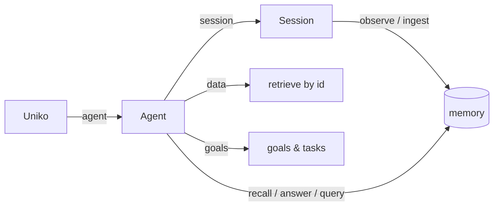

# Working with the Facade

The `Uniko` facade is the single public entry point to the memory system. This guide is the full
tour — from building an instance to every operation you'll reach for — with the idioms and the mental
model that tie them together. The [Quick Start](../getting-started/quickstart.md) is the 15-minute
taste; this is the map.

## The mental model

You program against **intentions**, not mechanisms. The facade hides the engine (`KnowledgeBase`, the
ingest pipeline, the query engine) behind a small set of verbs: *observe*, *recall*, *answer*,
*forget*. Everything hangs off one owning handle.



| Layer | What it is | You get it from |
|---|---|---|
| **`Uniko`** | the instance — owns the store, models, pipeline | `Uniko::open` / `builder()` |
| **`Agent`** | an identity that reads/writes, scopable | `memory.agent(id)` |
| **`Session`** | a conversation thread | `agent.session(id)` |

The rule of thumb: **write** through a `Session` (`observe` / `ingest`), **read** through the `Agent`
(`recall` / `answer` / `query`), **retrieve by id** through `agent.data()`, **plan** through
`agent.goals()`.

---

## 1. Build an instance

The zero-config constructors use the benchmark-validated defaults:

```rust
use uniko_memory::Uniko;

let memory = Uniko::in_memory().await?;        // ephemeral (tests, scratch)
let memory = Uniko::open("./agent-memory").await?;  // persistent, file-backed
```

Reach for the builder to turn on capabilities:

```rust
use uniko_memory::{EmbeddingConfig, LlmSpec, Uniko};

let memory = Uniko::builder()
    .path("./agent-memory")
    .embedding(EmbeddingConfig::bge_small_en_v15())          // swap the embedder
    .llm(LlmSpec::openai("generate/answer", "gpt-4o-mini", None))   // enables answer()
    .streaming(true)                                         // enables submit()/flush()
    .scope_to_agent()                                        // reads default to the agent's visibility
    .build()
    .await?;
```

| Builder method | Effect |
|---|---|
| `.path(p)` / `.in_memory()` | Where the store lives. |
| `.embedding(EmbeddingConfig)` | The embedder (vector search). |
| `.llm(LlmSpec)` | A generation model — **required for `answer()`**. Call it once per model; each call adds one. |
| `.answer_alias(alias)` | Which generation model `answer()` uses: an `.llm()` alias or one from the `catalog_path` file. Defaults to the first `.llm()`. |
| `.prefetch(PrefetchPolicy)` | When models load: `Eager` (default) before `build()` returns, `Lazy` on first use, `Background` on a task. |
| `.runtime(SharedRuntime)` | Open over a runtime shared with other instances instead of loading models again. |
| `.require([Requirement])` | Models or stages `build()` must have ready; it fails with `UnikoError::NotReady` otherwise. See [Require models at startup](#require-models-at-startup). |
| `.readiness_timeout(Duration)` | How long `build()` waits for the required models to load. |
| `.streaming(bool)` | Enables the fire-and-forget `submit`/`flush` lane. |
| `.scope_to_agent()` / `.scope(RecallScope)` | Default read visibility. |
| `.extractor(Arc<dyn ModalityExtractor>)` | An image/audio/video extractor: a `TextExtractor` over your function, or your own `ModalityExtractor` (`prepare` outside the transaction, `apply_in_tx` inside it). Without one, image/audio/video sources return `UnikoError::Unsupported`. See [Images, Audio and Video](multimodal.md). |
| `.model_extractor(ModelExtractor)` | An extractor backed by catalog models: OCR, captions, document extraction or transcription by alias, and a composer for video. `build()` refuses a mode the modality or catalog can't serve. See [Images, Audio and Video](multimodal.md#models-from-the-catalog). |
| `.raw_config(UnikoConfig)` | Drop in a fully-tuned config (see [Configuration](configuration.md)). |

**`LlmSpec`** picks the generation model: `openai(alias, model, base_url)` (reads `OPENAI_API_KEY`),
`openai_with_key_env(...)` for a custom key var, or `llamacpp(alias, model, base_url)` for a
llama.cpp `llama-server` you run yourself. Any other compiled generation provider goes through
`new(alias, provider, model)`, with `.option(key, value)` for provider options and
`.api_key_env(var)` for the credential (for `remote/vertexai` it sets that provider's
`api_token_env` option):

```rust
let claude = LlmSpec::new("generate/claude", "remote/anthropic", "claude-sonnet-4-5")
    .api_key_env("ANTHROPIC_API_KEY");
let memory = Uniko::builder()
    .llm(LlmSpec::openai("generate/answer", "gpt-4o-mini", None))
    .llm(claude)
    .answer_alias("generate/claude")
    .build()
    .await?;
```

The compiled generation providers are `remote/anthropic`, `remote/azure-openai`, `remote/cohere`,
`remote/gemini`, `remote/llamacpp`, `remote/mistral`, `remote/openai` and `remote/vertexai`
(`uniko_store::GENERATION_PROVIDERS`). Aliases take the `task/name` form. `build()` checks every
`LlmSpec` before it opens the store, and fails with `UnikoError::Config` naming the alias on:

- a provider that is not compiled in or cannot generate;
- an option the provider does not accept;
- a credential passed inline (`api_key`, `token`, ...) instead of through `api_key_env`;
- the same alias registered twice;
- an `answer_alias` that is not in the catalog or is not a generation model.

A spec's `Debug` output shows the option keys, never their values. Remote endpoints are not called
until the first request, so a wrong key or URL still surfaces then.

### Sharing models between instances

Each instance loads its own models by default. To run several (one store per user, say) without
loading every model several times, build one `SharedRuntime` and open each instance over it:

```rust
let runtime = Uniko::builder().build_runtime().await?;       // loads the default models once
let alice = Uniko::builder().path("./alice").runtime(runtime.clone()).build().await?;
let bob = Uniko::builder().path("./bob").runtime(runtime.clone()).build().await?;
```

Each instance keeps its own graph; only inference is shared. `build_runtime()` uses the builder's
model settings (embedding, reranker, NLP, catalog file and `.llm()` specs) and its `.prefetch()`
policy. A builder using `.runtime()` must name the same models: `build()` fails with
`UnikoError::Config` naming the alias when the runtime lacks one or holds a different model, provider,
revision or options for it (execution providers may differ). LLMs belong to the runtime: the
builder need not repeat its `.llm()` specs, and the answer alias of the builder that built the
runtime (its `.answer_alias()`, else its first `.llm()`) answers unless `.answer_alias()` names
another. A repeated spec must match the runtime's exactly, options included.
Shutting one instance down leaves the runtime loaded for the others, and
the load state in `capabilities()` is shared across them.

One layer down, `SharedRuntime::build(&config, extra, policy)` with
`KnowledgeBase::in_memory_shared` / `open_shared` does the same. `build_shared_runtime` and
`open_with_runtime` are deprecated: they skip that check, and a store opened that way does not
know its catalog, so `model_status()` lists every alias the runtime holds.

!!! note "Capabilities, not wiring"
    You never construct a `KnowledgeBase`, a pipeline, or a model catalog. The builder is the only
    place you make capability choices; everything you don't set runs the defaults.

---

## 2. Agents and sessions

```rust
let agent = memory.agent("assistant");      // an identity; cheap to mint
let mut session = agent.session("chat-42"); // a conversation thread
```

One instance can mint many agents (`alice`, `bob`); each can be scoped to what *it* may see. A session
groups turns and lets attachments attach to the right message.

### Register an agent

`memory.agent(id)` only makes a handle; nothing is written. To record an agent's identity before it
does anything, register it:

```rust
use uniko_memory::{AgentRegistration, EnsureOutcome};

let reg = agent.register(AgentRegistration::new().name("Reporter")).await?;
assert_eq!(reg.outcome, EnsureOutcome::Created); // later calls return Existing
```

Registration writes one `Participant` of kind `agent` and nothing else: no session, message or
action. It's idempotent and safe to call concurrently, and the participant survives a reopen. A
participant that already exists keeps its name, metadata and memberships. If it has kind `unknown`
(ingest and `add_org_member` create participants that way), it becomes `agent` and the outcome is
`Upgraded`. A later turn from the agent never sets the kind back to `unknown`.

Registering is optional. Goals, tasks, actions and tool calls create the agent's participant
themselves, so `agent.goals().create(...)` works on a fresh store.

---

## 3. Write memory

### Conversation — `observe`

`observe` is the first-class write: it runs the full ingest pipeline (chunking, entity + observation
extraction) and **commits before returning**, so the next read sees it.

```rust
use uniko_memory::{IngestSource, Turn};

let result = session
    .observe(
        Turn::new("alice", "here's the spec we discussed")
            .addressed_to(vec!["assistant".into()])
            .attach(IngestSource::path("spec.pdf")),   // a document rides the turn
    )
    .await?;
// result.message       -> the ingested message
// result.attachments   -> each attachment, linked to this turn (provenance)
```

A `Turn` is a builder: `Turn::new(sender, content)` plus `.id(...)` (idempotency), `.at(timestamp)`,
`.addressed_to(...)`, `.metadata(k, v)`, `.attach(IngestSource)`, `.attachments(iter)`.

!!! note "`sender_role` is a reserved metadata key"
    `.metadata(...)` is free-form with one exception: `metadata["sender_role"]` is the only way
    to set the `role` property on the `SENT_BY` edge, which is what makes role-scoped queries
    ("what did the assistant say?") work. Set it with
    `.metadata("sender_role", json!("assistant"))`.

!!! tip "Attachments carry provenance"
    A document shared with `.attach(...)` is linked to the exact message and speaker that shared it —
    so later a recalled fact can cite *"per spec.pdf, shared by alice."* See
    [Recall & Retrieval](retrieval.md).

### Standalone documents — `ingest`

To load a corpus with no conversation, use one blob verb and one blob type:

```rust
session.ingest(IngestSource::path("handbook.md")).await?;             // MIME sniffed
session.ingest(IngestSource::bytes(pdf).with_mime(Mime::parse("application/pdf")?)).await?;
```

`IngestSource::{text, bytes, path}` builds the blob; `.with_mime(...)`, `.with_id(...)`,
`.with_path(...)` override routing. `IngestSource.metadata` is a public map with one reserved
key of its own: `metadata["content_type"]` overrides the content type recorded on the
resulting `:Artifact` (useful when, say, fetched bytes should be recorded as the source URL's
type rather than the sniffed one). `.with_mime(...)` takes a `Mime` (re-exported from
`uniko_memory`); build one with `Mime::parse("application/pdf")?` or `"application/pdf".parse()?`. The
returned `IngestOutcome` tells you what it became (`Artifact` / `Pdf`) and carries the `artifact_id`
for later retrieval. An unsupported modality surfaces as a `UnikoError::Unsupported` error, not an
`IngestOutcome` variant.

### High throughput — streaming

When you don't need read-after-write, the streaming lane (built with `.streaming(true)`) trades
immediacy for throughput:

```rust
session.submit(Turn::new("alice", "...")).await?;       // fire-and-forget
session.submit_source(IngestSource::text("notes")).await?;
session.flush().await?;                                  // barrier: drain the pipeline
```

A degraded stage in streamed work (see [Ingest diagnostics](#ingest-diagnostics)) has no call to
report on, so it is counted in `memory.health()`: `ingest.degradations` maps `stage:code` to a
count since start, over items that succeeded (a failed item goes to the dead-letter queue).

### Dead letters — recovering failed streamed items

A streamed item whose ingest fails is kept as a dead letter, with its payload, so it can be
inspected, retried and resolved:

```rust
use uniko_memory::{DeadLetterFilter, DeadLetterStatus};

let dl = memory.dead_letters();
for letter in dl.list(&DeadLetterFilter::new().status(DeadLetterStatus::Pending)).await? {
    println!("{} failed in {}: {} ({:?})", letter.id, letter.step, letter.error, letter.error_kind);
}
dl.retry(&first, false).await?;             // resubmit one; its outcome lands on the letter
let report = dl.retry_pending(100).await?;  // or every pending one that can succeed
session.flush().await?;                     // waits for the retries just started
dl.resolve(&second, Some("source was corrupt")).await?;  // give up on another, keeping the record
```

| Status | Meaning |
|---|---|
| `pending` | Waiting for a retry; `next_retry_at` says when one is due. |
| `retrying` | A retry has been resubmitted. |
| `exhausted` | Out of retries, or failed in a way a retry can't fix. |
| `resolved` | A retry succeeded (`resolution = "retried"`), or `resolve` was called. |
| `legacy` | Written by an earlier uniko that didn't keep payloads: can be resolved, not retried. |

**Which failures can be retried.**
- **Permanent:** an id conflict, an unsupported or invalid payload, an incompatible store, and
  configuration, schema or Locy errors fail the same way every time. They're stored `exhausted` with `retriable = false`,
  and `retry` refuses them unless `force` is set.
- **Retriable:** every other kind, for example model, timeout, storage, search or internal
  failures.
- **No payload:** a payload that can't be stored, such as a file path that isn't valid UTF-8,
  leaves a letter that is kept for inspection but is `exhausted` and not replayable.

**What a retry does.**
- It resubmits the stored payload unchanged, so a message keeps its id, sender, source and the
  agent it was submitted under.
- `submit_source` records no agent, so a document or file letter has `agent_id = None`.
- Ingest dedups by id and content, so replaying an item that partly landed doesn't write it twice.

**The retry limit.**
- Each retry counts, and a letter stops at `dead_letter_max_retries` (default 3).
- The limit is fixed on each letter when it's stored, so changing the config later doesn't affect
  existing letters.
- With a limit of 0, retriable failures are stored `exhausted`.
- A retry that never ran to the end isn't counted: one that couldn't be queued because the ingest
  queue was full, one cut short by shutdown, or one interrupted by a crash.

**Restarts.** Letters persist. When a streaming instance starts, any letter left `retrying` by a
process that stopped goes back to `pending`. A non-streaming instance can still resolve such a
letter.

**Resolving.**
- `resolve` changes only the letter, and drops its stored payload.
- It refuses a letter whose retry this process is still running.
- Resolved letters are kept. There's no purge yet.

**Health.** `memory.health()` counts `dead_lettered`, `retries` and `retries_succeeded` since
start. `dl.counts()` gives the stored totals per status.

**Handles.** Like an `Agent` or `Session`, a `DeadLetters` handle shares the instance, so drop it
before `memory.shutdown()`.

**Automatic retries** are off by default. With `dead_letter_auto_retry = true`, a background task
retries pending, retriable letters once their backoff has elapsed:
- the first retry waits `dead_letter_retry_backoff_ms` (default 30 s);
- each later retry waits twice as long, up to `dead_letter_retry_max_backoff_ms` (default 1 h);
- the task runs every backoff interval, at most once a second and at least once a minute;
- each pass takes at most 32 letters, and letters still stop at the retry limit;
- permanent failures are never retried automatically.

The schedule is stored on the letters, so it carries across restarts. `flush` waits for a retry
the task has already started, but not for one that isn't due yet. The task stops when the
instance shuts down or is dropped. A store opens in one handle at a time, within a process and
across processes (see [Changing the Embedding Model](model-migration.md#migrate-in-place)), so only
one instance ever retries a store's dead letters.

Binary payloads are stored as JSON, about three to four times their size, until they're resolved.

### Ingest diagnostics

Ingest is best-effort in the same way recall is: without the NLP model, rules extract entities
and observations; a PDF that cannot be parsed is stored without chunks. `ObserveResult`,
`UnitResult`, the `IngestOutcome` from `ingest` (`outcome.diagnostics()`), the `ToolCallResult`
from `observe_tool` and the `RecordActionResult` from `record_action` carry `diagnostics` listing
what each stage did. For a multi-turn unit they are on `UnitResult`, merged with `count` the number
of messages; each turn's list is empty. A replayed unit or a deduplicated source wrote nothing and
reports nothing. The free function `ingest_source` collects nothing; use `Session::ingest`.

| Stage | Records |
|---|---|
| `nlp` | `applied`, or `fallback` / `nlp_unavailable` or `nlp_failed` (rules ran instead), or `skipped` / `not_compiled` on a build without `onnx`. From `record_action`, `target` is `action_entities` and a failure is `failed`: its entity links are skipped, with no rule fallback. |
| `observation_model` | `applied`, or `fallback` / `rule_based` when observations came from rules. `onnx` builds only. |
| `observation_rules` | `fallback` / `custom_rules_unloadable`: `observation_rules_path` could not be loaded, so the bundled rules ran. Recorded each time the rules are used; a failed load is retried at most once a minute, and logged at `warn` once per attempt. |
| `pdf_extraction` | `failed` / `tiered_failed` or `extraction_failed`, with the artifact id as `target`: it is stored without (or with fewer) chunks. The id is the one the source was given (`IngestSource` `with_id`) or a generated one, so it is not a secret only if yours is not. |
| `artifact_embedding` | `failed` / `pool_failed`: the artifact's own vector is left for the backfill migration. |
| `extractor_post_commit` | `failed` / `post_commit_failed`, with the artifact id as `target`: a registered extractor's post-commit step failed. |
| `media_extraction` | `skipped` / `no_audio_track`, with the transcription alias as `target`: a video extractor's composer returned no audio track while `transcribe` is set. |

Whether models loaded at startup is reported by [`capabilities()`](#9-check-what-is-available),
not per call. To refuse to run without a stage at all, [require it at
startup](#require-models-at-startup).

### End of conversation — `finalize`

Whichever write lane you used, call `finalize()` when a conversation wraps up:

```rust
let report = session.finalize().await?;
```

It chunks the whole transcript and aggregates the session's observations into dense chunks wired
`ABOUT` the entities and participants involved. Those are the surfaces that session-scoped recall
and the Phase 1 session boost retrieve — without them a session contributes only its per-turn
chunks, and the default `phase1_strategy = "boost"` has nothing to score.

It is cheap and idempotent when the session has not grown (nothing is rewritten, nothing is
re-embedded), so calling it periodically during a long conversation is fine. `summarize()` calls it
for you on a best-effort basis, and `finalize()` flushes the streaming pipeline first.

`finalize()` also stamps the Session's `ended_at` with its latest message time. Note a
Session counts as *open* while `ended_at` is null, so finalizing takes it out of the
inactivity auto-close sweep; finalizing again after more turns re-stamps it.

To backfill a knowledge base ingested before this existed:

```rust
for sid in agent.unfinalized_session_ids().await? {
    agent.finalize_session(&sid).await?;
}
```

### Compile knowledge — `consolidate`

`observe` extracts Entities and Observations. Turning those into `Fact`s — voting on the
canonical claim, stamping bitemporal validity, retiring contradicted beliefs — is
consolidation:

```rust
let report = agent.consolidate().await?;
println!(
    "{} observations -> {} facts",
    report.cycle.observations_processed, report.cycle.facts_created
);
```

It runs on the calling task and needs no streaming pipeline. An instance built with
`.streaming(true)` also consolidates on its own, on a 20-observation threshold or a 15-minute
timer, and runs the cortex sweep (procedure promotion, topic detection) afterwards.

By default the cycle groups Observations by the rule-based triples extracted at ingest, with no
model call. `consolidate_with` can refine each triple with a generation model first — one call per
unprocessed Observation, so keep it to an offline or scheduled pass:

```rust
let report = agent
    .consolidate_with(ConsolidateOptions::llm_triples("generate/my-llm"))
    .await?;
println!(
    "{} of {} triples refined",
    report.cycle.triples_refined, report.cycle.triples_requested
);
```

The alias must be registered (for example with `UnikoBuilder::llm`) and be a generation model;
otherwise `consolidate_with` returns `UnikoError::Config` before doing any work. Observations the
model declines or answers unparseably keep their rule-based triple, as do those whose call fails;
`report.cycle.triples_failed` counts the latter, so an unreachable endpoint shows up as
`triples_failed == triples_requested` rather than as a silent fallback.

---

## 4. Read memory — three altitudes

The same memory reads at whichever altitude the task needs:

```rust
// (a) ranked context, ready to drop into a prompt
let bundle = agent.recall("what's the deadline?").await?;        // ContextBundle

// (b) a finished answer (recall + the configured LLM)
let answer = agent.answer("when is the deadline?").await?;       // Answer

// (c) exact rows you specify (read-only Cypher)
let rows = agent.query("MATCH (m:Message) RETURN m.content AS c").await?;
```

- **`recall`** does the retrieval cascade and hands back ranked, deduped, budget-trimmed context.
- **`answer`** adds the LLM call and returns generated text plus the grounding (needs `.llm(...)`).
- **`query`** is exact and deterministic — you write the graph pattern, you get raw `Record`s.

### Scoping

Every read has an `_in` twin that confines it to a session, participant, or time window:

```rust
use chrono::{Duration, Utc};
use uniko_memory::Scope;

let scope = Scope::default()
    .sessions(["chat-42"])
    .since(Utc::now() - Duration::days(7));

let bundle = agent.recall_in("deadline", scope.clone()).await?;
let rows   = agent.query_in("MATCH (n:Message) WHERE id(n) IN $allow RETURN n", &scope).await?;
```

`recall_in`/`answer_in` apply the scope (and viewer visibility) for you; `query_in` binds the in-scope
node-ids as `$allow` for your Cypher. Full treatment in [Recall & Retrieval](retrieval.md).

---

### Diagnostics and strict recall

Recall is best-effort. A stage that cannot run degrades and the recall still succeeds: a
reranker that errors keeps the fused order, a missing embedder leaves keyword search only.
`ContextBundle::diagnostics` says what happened to each stage that was asked for. A stage that is
turned off records nothing.

```rust
use uniko_memory::{RecallOverrides, Scope};

let bundle = agent.recall("when does the deploy key rotate").await?;
for d in &bundle.diagnostics {
    if d.status.is_degraded() {
        eprintln!("degraded: {d}"); // e.g. "rerank fallback rerank_failed (rerank/default)"
    }
}

// Or refuse a weaker result outright:
let strict = RecallOverrides::default().strict(true);
let bundle = agent.recall_with("...", Scope::default(), &strict).await?; // UnikoError::Degraded
```

| Stage | Records |
|---|---|
| `query_embedding` | `applied`, with `count` the number of query variants embedded, or `failed` / `embed_failed`: vector search is skipped and recall is keyword-only. |
| `query_analysis` | `applied`, or `fallback` / `nlp_unavailable` or `nlp_failed`: rule-based entity extraction ran instead. Recorded on `onnx` builds only. |
| `sparse` | `applied` per label, or `failed` / `query_failed` (e.g. no hybrid embedder). Only with `recall_sparse_enabled`. |
| `colbert` | `applied`, `skipped` / `no_candidates`, or `fallback` / `query_embed_failed` or `maxsim_failed`: the fused order is kept. `fallback` / `unscored` (target `Chunk` or `Observation`) alongside `applied`: some candidates had no token vectors yet and were ranked below every rescored one. |
| `rerank` | `applied`, `skipped` / `no_candidates`, or `fallback` / `rerank_failed`: the fused order is kept. |
| `source` | `failed` / `query_failed`, naming what contributed nothing: a candidate source (e.g. `phase2:Episode:vector`, `phase3:Chunk:Message`, `phase3:entity:Chunk`), or a ranking input (`entity_seeds`, `entity_drift`, `session_boost`, `entity_type_match`, `modality_presence`). |
| `provenance` | `failed` / `provenance_unresolved`: items keep empty category, source or lineage fields. |

The reranker, ColBERT and the Chunk sparse channel run only when the cascade reaches Phase 3. A
recall answered by an earlier phase lists each of them that was asked for as `skipped` /
`not_reached`, so a stage that never ran is told apart from one turned off. Applied stages after
the first carry no counts: they are taken before access control filters the bundle, and could
otherwise reveal how many hidden items matched.

With `strict`, any `fallback` or `failed` stage other than `provenance` (which is metadata) turns
the recall into `UnikoError::Degraded`, listing those stages. Strict is a per-call override
(`RecallOverrides::strict`, or `RecallConfig::strict` for `recall()` directly); `recall`,
`recall_in` and `answer` are always best-effort, and `Answer::context.diagnostics` says what their
recall did. Diagnostics carry no query or content text, only a stage, a status, a stable code and
at most a label, alias or source name.

---

## 5. Provenance and retrieval

Every recalled item answers **what** it is and **where** it came from:

```rust
for item in &bundle.items {
    println!("[{:?}{}] {}",
        item.kind,                                       // Chunk / Fact / Observation / …
        if item.kind.is_derived() { " derived" } else { "" },
        item.content);
    for src in &item.sources { /* Message | Attachment | Document | Session | Tool — the lineage */ }
}
```

`agent.answer(...)` carries the same lineage, so answers are citable for free:

```rust
let ans = agent.answer("when is the deadline?").await?;
println!("{}", ans.text);
for src in ans.citations() { /* what the answer was grounded in */ }
```

And `agent.data()` dereferences those source ids into content — recall is the index lookup, `data` is
the document fetch:

```rust
let view  = agent.data().artifact("spec.pdf").await?;        // metadata + reassembled text
let bytes = agent.data().artifact_bytes("spec.pdf").await?;  // the original blob
let media = agent.data().media_sources("photo-1").await?;     // the image/recording a text came from
let msg   = agent.data().message("m-12").await?;             // sender / session / attachments
```

This closes the loop with `observe`: the `artifact_id` it returned is the id you fetch by.

---

## 6. Goals and tasks

`agent.goals()` is the goal/task lifecycle surface — what the agent is pursuing, did, and plans to do:

```rust
use uniko_memory::CreateGoalParams;

let goal = agent.goals().create(CreateGoalParams {
    goal_id: Some("g-release".into()),
    title: "Ship the release".into(),
    ..Default::default()
}).await?;

agent.goals().start("g-release").await?;
agent.goals().complete("g-release", Some(serde_json::json!({ "shipped": true }))).await?;

let active    = agent.goals().active().await?;       // current work
let planned   = agent.goals().planned().await?;      // future plans
let completed = agent.goals().completed().await?;    // history + results
let ctx       = agent.goals().context("g-release").await?;  // the goal's working subtree
```

Phases (`Planned`/`Active`/`Completed`/`Abandoned`) derive from status; completing with a result
records it. Tasks live under goals the same way. See [Agent Tools](agent-tools.md).

---

## 7. Reason over memory

Beyond retrieval, the agent can reason with the logic surface — rules, what-ifs, abduction:

```rust
agent.define_rule("vip", "CREATE RULE vip AS MATCH (p:Participant)... YIELD ...").await?;
let rows = agent.run_rule("vip", &["p"], params).await?;

// hypothetical, guaranteed rollback — the real graph is never touched:
let derived = agent.assume("ASSUME { CREATE (:Fact {subject:'srv'}) }")
    .then_query("MATCH (f:Fact {subject:'srv'}) RETURN f")
    .run().await?;
```

Full coverage in [Reasoning with Locy](reasoning-with-locy.md).

---

## 8. Forget and delete

Memory you can't curate is a liability. The verbs split by intent:

```rust
session.forget_turn(msg_id).await?;       // SOFT: hidden from recall, lineage kept
session.delete_turn(msg_id).await?;       // HARD: cascade chunks/observations, splice the thread
session.delete_document(artifact_id).await?;
agent.delete_session("chat-42").await?;   // a whole conversation
agent.forget_participant("alice").await?; // GDPR erasure of a person's data
memory.purge().await?;                    // dev/test wipe
```

Each returns a `DeletionReport` of exactly what changed. **Forget is soft** (redact, keep audit
lineage); **delete is hard** (cascade the owned subtree). When a derived `Fact` loses its last
supporting evidence it's soft-invalidated with a recorded reason, not silently dropped.

---

## 9. Check what is available

`memory.capabilities().await` returns a `Capabilities` report without loading anything:

- the optional engine features this build compiled in;
- the modalities with a registered extractor;
- each catalog model alias with its load state (`NotLoaded`, `Loading`, `Loaded` or `Failed` with
  the error), as the model runtime reports it;
- the answer alias, and whether OCR is compiled in and enabled.

```rust
let caps = memory.capabilities().await;
for model in caps.models.unwrap_or_default() {
    println!("{} ({:?}) via {}: {:?}", model.alias, model.task, model.provider_id, model.state);
}
```

Prefetch at open (with the default `PrefetchPolicy::Eager`) loads each alias in turn and keeps
going past a failure, which it logs at `warn`. The runtime records it, and a timed-out load, as
`Failed` until a later load succeeds. The state counts every load, including one made only by
uni-db's auto-embedding on write. `extractors` lists only extractors you registered; built-in
text, code, markup, structured and PDF ingest are always available. Model entries never carry provider options; credentials show only as the
`api_key_env` variable name, and `base_url` (the configured endpoint, or a remote provider's
default one) loses any userinfo and query. The same per-alias report
is available one layer down as `KnowledgeBase::model_status()`.

### Require models at startup

By default every model is optional: one that fails to load is recorded and the instance still
builds. An application that cannot serve without a model says so with `.require()`, and
`build()` then fails with `UnikoError::NotReady`, listing every unmet requirement:

```rust
use std::time::Duration;
use uniko_memory::{PrefetchPolicy, Requirement, Uniko, UnikoError};

let built = Uniko::builder()
    .path("./memory")
    .prefetch(PrefetchPolicy::Lazy)          // optional models load on first use
    .require([Requirement::Embedder, Requirement::Nlp])
    .readiness_timeout(Duration::from_secs(120))
    .build()
    .await;
if let Err(UnikoError::NotReady(failures)) = &built {
    for f in failures {
        eprintln!("{} unmet: {} {:?} {:?}", f.requirement, f.code, f.alias, f.error);
    }
}
```

| Requirement | Met when |
|---|---|
| `Alias(alias)` | The catalog alias loads. |
| `Embedder` | `embed/default` loads, and `embed/hybrid` when the config adds one. |
| `Reranker` | The configured reranker loads: `rerank/default`, or for the `colbert` style the hybrid embedder. |
| `Nlp` | `nlp/default` loads and the NLP pipeline starts (needs the `onnx` feature). |
| `Ocr` | `pdf-ocr` is compiled in, `ocr.enabled` is set, and `ocr/default` loads. |
| `Generator` | The answer alias is set and loads. |
| `Extractor(modality)` | An extractor is registered for the modality, and a model extractor's aliases load. |
| `Accelerated(alias)` | The alias loads, and a non-CPU execution provider it asks for is among the providers its sessions attached. `["cuda", "cpu"]` fails as `not_accelerated` when the model runs on CPU: on a build without `gpu-cuda`, on a GPU build whose CUDA libraries or driver are missing, or when the accelerator's output disagreed with CPU at load (uni-xervo then moves the model to CPU). Every `local/onnx` model reports its providers except document extraction; any other alias (a remote model, whisper.cpp) fails as `not_supported`. |

A requirement the catalog, the compiled features or the registered extractors cannot meet fails
before the store is created, without contacting any provider. The rest are checked after the store
opens: `build()` loads the required aliases first, whatever the prefetch policy, and only then runs
the policy for the other aliases. `readiness_timeout` covers the required aliases only, so under
the default `Eager` policy `build()` still waits for the rest afterwards. When a check fails,
`build()` shuts the store down before returning, so a persistent path can be opened again.

A remote model (an OpenAI-compatible endpoint, a hosted embedder) counts as loaded once its client
is built and its API-key variable is set: by default nothing contacts the server. Add
`.verify_remote(true)` to the builder to also check that each required remote alias is reachable
and accepts its credential. Each gets one cheap authenticated request (a model lookup for OpenAI
and most providers, `/health` for llama.cpp), at most eight at a time, within `readiness_timeout`.
A failure is `verification_failed`, and its `error` starts with the reason: `unauthorized`,
`unreachable`, `not found`, `rate limited`, `timed out`, `unavailable`, `configuration error` or
`failed`. A check still running when `readiness_timeout` runs out is cancelled and reported as
`timed_out`.
The setting also applies to every later `check_readiness` on the instance, so a frequent health
probe makes these requests each time.

Each failure carries a stable `code`:

| Code | Meaning |
|---|---|
| `not_in_catalog` | The alias is not in the model catalog. |
| `not_configured` | The stage is off in the config (the reranker, OCR, no answer alias). |
| `not_compiled` | The stage needs a Cargo feature this build lacks. |
| `no_extractor` | No extractor is registered for the modality. |
| `load_failed` | The model failed to load; `error` holds the error, with URL userinfo and query removed. |
| `timed_out` | The model had not loaded when the timeout ran out. |
| `nlp_unavailable` | The NLP models loaded but the pipeline could not start. |
| `not_accelerated` | None of the accelerators the model asked for is among its active providers. |
| `verification_failed` | With `verify_remote`, the remote endpoint could not be reached or rejected the credential; `error` holds the reason. |
| `not_supported` | The check cannot be made for this model (an `Accelerated` requirement on a model that does not report providers). |

`memory.check_readiness(&requirements, timeout).await` runs the same check on a built instance,
loading what it needs, and returns the unmet requirements instead of failing, for a health or
readiness endpoint. A model that failed to load is tried again on every call, so pass a timeout,
and cache the result between frequent probes.

---

## 10. Shut down

```rust
drop(session);
drop(agent);
memory.shutdown().await?;   // drains workers, then closes the store
```

`shutdown` needs sole ownership — drop outstanding `Agent`/`Session` handles first; the error tells
you if one is still alive.

---

## Putting it together

A realistic end-to-end loop — observe a conversation with an attachment, answer with citations, fetch
the source, track a goal, then curate:

```rust
use uniko_memory::{CreateGoalParams, IngestSource, LlmSpec, Turn, Uniko};

#[tokio::main]
async fn main() -> anyhow::Result<()> {
    let memory = Uniko::builder()
        .in_memory()
        .llm(LlmSpec::openai("generate/answer", "gpt-4o-mini", None))
        .build()
        .await?;
    let agent = memory.agent("assistant");
    let mut session = agent.session("chat-1");

    // Write: a turn plus the spec it references.
    let observed = session
        .observe(
            Turn::new("alice", "the deadline is in the attached spec")
                .id("m-1")
                .attach(IngestSource::text("# Spec\n\nDeadline: Friday")),
        )
        .await?;

    // Read: a cited answer.
    let answer = agent.answer("when is the deadline?").await?;
    println!("{}", answer.text);
    for src in answer.citations() {
        println!("  cited: {src:?}");
    }

    // Retrieve: open the source document.
    if let uniko_memory::IngestOutcome::Artifact(a) = &observed.attachments[0] {
        let doc = agent.data().artifact(&a.artifact_id).await?;
        println!("source text: {:?}", doc.map(|d| d.text));
    }

    // Plan: track and complete a goal.
    agent.goals().create(CreateGoalParams {
        goal_id: Some("g-1".into()),
        title: "Confirm the deadline".into(),
        ..Default::default()
    }).await?;
    agent.goals().complete("g-1", Some(serde_json::json!({ "deadline": "Friday" }))).await?;

    // Curate: forget a turn, then close cleanly.
    session.forget_turn("m-1").await?;
    drop(session);
    drop(agent);
    memory.shutdown().await?;
    Ok(())
}
```

---

## The whole surface at a glance

| Stage | Verb(s) | Returns |
|---|---|---|
| Build | `Uniko::open` / `builder().build()` | `Uniko` |
| Identity | `memory.agent(id)` / `agent.session(id)` | `Agent` / `Session` |
| Write | `session.observe(Turn)` / `session.ingest(IngestSource)` | `ObserveResult` / `IngestOutcome` |
| Finalize | `session.finalize()` / `agent.finalize_session(id)` | `FinalizeReport` |
| Compile | `agent.consolidate()` / `consolidate_with(options)` | `ConsolidationReport` (`cycle`, `procedures`, `topics`) |
| Read | `agent.recall` / `answer` / `query` (+ `_in`) | `ContextBundle` / `Answer` / `Vec<Record>` |
| Retrieve | `agent.data().message` / `artifact` / `artifact_bytes` / `media_sources` | `Option<…View>` / `Option<Vec<u8>>` / `Vec<MediaSourceView>` |
| Plan | `agent.goals()` (create / transition / read) | `GoalView` / `TaskView` / `GoalContext` |
| Reason | `agent.define_rule` / `run_rule` / `assume` / `abduce` | rows / derivations |
| Curate | `forget_*` / `delete_*` / `purge` | `DeletionReport` |
| Close | `memory.shutdown()` | `()` |

## Where to go deeper

<div class="feature-grid" markdown>
<div class="feature-card" markdown>
### [Recall & Retrieval](retrieval.md)
The three altitudes, provenance, citations, and `agent.data()` in depth.
</div>
<div class="feature-card" markdown>
### [Agent Tools](agent-tools.md)
Goals/tasks and the episode/action/fact recording primitives.
</div>
<div class="feature-card" markdown>
### [API Reference](../reference/api.md)
Every method, signature, and field — the catalog behind this tour.
</div>
</div>
